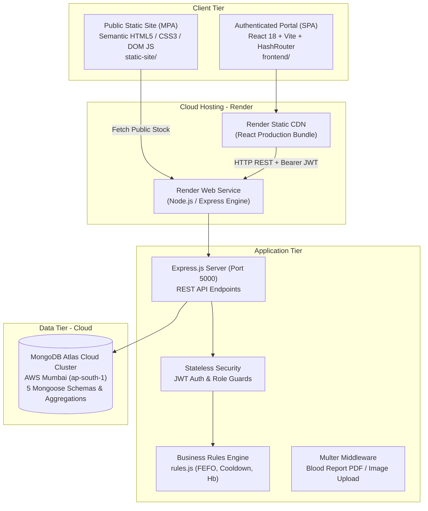

# 🩸 Blood Bank & Donation Management System
> **A Cloud-Native Full-Stack Healthcare Application & Modern Architecture Migration**  
> Built with Semantic HTML5, CSS3, DOM JS, React 18 (Vite), Node.js, Express.js, and MongoDB Atlas. Deployed continuously on Render Cloud.

---

## 🌐 Live Production Links & Credentials

| Service | Live URL | Status |
| :--- | :--- | :--- |
| **Frontend Portal (React 18 + Vite)** | **[https://blood-bank-and-donation-management.onrender.com](https://blood-bank-and-donation-management.onrender.com)** | 🟢 Active (HTTP 200) |
| **Backend REST API (Node + Express)** | **[https://blood-bank-and-donation-management-system-u257.onrender.com/api/health](https://blood-bank-and-donation-management-system-u257.onrender.com/api/health)** | 🟢 Active (Health: OK) |
| **Public Stock Live Endpoint** | **[Live Stock JSON API](https://blood-bank-and-donation-management-system-u257.onrender.com/api/public/stock)** | 🟢 Connected to Atlas |
| **GitHub Repository** | **[Blood-bank-and-donation-management-system](https://github.com/twinklemaan/Blood-bank-and-donation-management-system)** | 🟢 Synced (`main` & `develop`) |

### 🔑 Demo Login Accounts

| Role | Username | Password | Access Rights & Operations |
| :--- | :--- | :--- | :--- |
| **Blood Bank Staff (Pune)** | `staff1` | `staff123` | Full Donor CRUD, Donation intake, Screening Pass/Fail, Lab report upload, Live stock |
| **Blood Bank Staff (Mumbai)** | `staff2` | `staff123` | Multi-bank inventory operations and regional donor management |
| **Hospital Representative** | `hosp1` | `hosp123` | Create emergency blood orders (Critical/Urgent/Normal), Check order status |

---

## 🏗️ System Architecture & Technology Stack



### Full-Stack Tier Breakdown

* **Static Public Web Layer (`static-site/`):** Pure semantic HTML5 (`<header>`, `<nav>`, `<main>`, `<article>`, `<aside>`, `<footer>`), CSS3 Flexbox and CSS Grid, and safe DOM manipulation (`document.createElement`).
* **Single Page Application Layer (`frontend/`):** React 18, Vite build tool, `HashRouter` (ensuring 100% reliable page reloads on static hosts), `AuthContext` for global session management, custom `useFetch` hook, and React `<ErrorBoundary>`.
* **Application & API Layer (`backend/`):** Node.js runtime, Express.js web framework, stateless JSON Web Token (JWT) authorization, bcrypt password hashing, Multer file upload with physical unlinking (`fs.unlink`), and Node `EventEmitter` audit logging.
* **Database Layer (MongoDB Atlas):** Managed cloud document database, Mongoose ODM schemas, embedded address documents, referenced collections (`ObjectId`), and real-time `$match` / `$group` stock aggregation pipelines.
* **CI/CD & Cloud Infrastructure:** GitOps continuous deployment on Render PaaS with automated GitHub webhook builds and managed TLS/HTTPS encryption.

---

## 📁 Repository Directory Structure

```text
Blood-Bank-and-Donation-Management-System/
├── backend/                  # Node.js Express REST API & MongoDB Atlas
│   ├── src/
│   │   ├── models/           # Mongoose Schemas (User, Bank, Donor, Donation, BloodRequest)
│   │   ├── routes/           # REST Controllers (auth, donors, donations, stock, requests)
│   │   ├── middleware/       # JWT auth guards (auth.js) & Multer file uploads (upload.js)
│   │   ├── app.js            # Express app configuration & dynamic CORS
│   │   ├── db.js             # Mongoose connection with Google Public DNS (8.8.8.8)
│   │   ├── rules.js          # Pure medical business validation functions
│   │   ├── events.js         # EventEmitter audit logger
│   │   └── server.js         # Server entry point (starts on port 5000)
│   ├── uploads/              # Storage directory for donor lab test reports
│   ├── seed.js               # Database seeder (2 banks, 3 users, 6 donors, 8 donations)
│   └── package.json
├── frontend/                 # React 18 + Vite Single Page Application (SPA)
│   ├── src/
│   │   ├── components/       # Reusable UI (Navbar, ProtectedRoute, ErrorBoundary)
│   │   ├── context/          # AuthContext (global user state & localStorage JWT)
│   │   ├── hooks/            # Custom hook useFetch (REST lifecycle wrapper)
│   │   ├── pages/
│   │   │   ├── staff/        # Donors.jsx, Donations.jsx, Stock.jsx, RequestsToFulfil.jsx
│   │   │   ├── hospital/     # RaiseRequest.jsx, MyRequests.jsx, AvailabilitySearch.jsx
│   │   │   ├── Login.jsx     # Staff and Hospital sign-in form
│   │   │   └── Register.jsx  # Self-service hospital onboarding
│   │   ├── App.jsx           # Client-side routing declarations via HashRouter
│   │   ├── main.jsx          # React DOM root initialization
│   │   └── index.css         # CSS Variables (:root), Flexbox, and CSS Grid layouts
│   ├── index.html            # SPA single HTML host document
│   └── package.json
├── static-site/              # Public Information & Awareness Multi-Page App (MPA)
│   ├── css/style.css         # External responsive stylesheet
│   ├── js/main.js            # DOM scripting querying live cloud API (/api/public/stock)
│   ├── js/validate.js        # Client-side RegExp validation for Indian phones & PIN codes
│   ├── index.html            # Public homepage with live stock cards
│   ├── about.html            # Blood compatibility matrix & donation rules
│   ├── donate.html           # Public donor registration & appointment form
│   └── contact.html          # Emergency hotlines and branch directory
├── postman/                  # Automated API Test Suite
│   ├── BloodBank.postman_collection.json
│   ├── BloodBank.postman_environment.json
│   └── run-tests.js          # Automated Newman CLI test execution script
├── docs/                     # Technical Architecture & Deployment Documentation
│   ├── DEPLOY_STEPS.md       # Step-by-step cloud deployment instructions
│   ├── GIT_STEPS.md          # Branching workflows (main & develop)
│   └── JENKINS_STEPS.md      # CI/CD pipeline automation setup
├── Jenkinsfile               # Multi-stage CI pipeline definition
├── render.yaml               # Cloud PaaS infrastructure-as-code specification
└── README.md                 # Master Project Documentation
```

---

## 🩺 Core Medical Business Rules & Logic

1. **Donor Age Restriction:** Must be between **18 and 65 years old** at the time of intake.
2. **Minimum Hemoglobin Threshold:** Must have laboratory $\text{Hb} \ge 12.5\text{ g/dL}$ to safeguard donor health.
3. **90-Day Donation Cooldown:** Candidate donors must wait a minimum of **90 days (3 months)** between whole blood donations.
4. **Blood Component Shelf-Life:** Red blood cell donations automatically expire after **42 days** (`donationDate + 42 days`).
5. **Medical Traceability (Referential Integrity):** Deleting a donor with historical donations is strictly prohibited to guarantee that every unit in inventory or transfused to a patient retains a permanent medical origin trail.
6. **FEFO Dispatch Algorithm (First Expired, First Out):** When hospital blood orders are processed, the system sorts available eligible batches by `expiryDate: 1`. Units closest to expiring are allocated first, minimizing perishable clinical waste.

---

## 📡 REST API Specifications

| Method | Endpoint | Access | Functionality |
| :--- | :--- | :--- | :--- |
| `POST` | `/api/auth/register` | Public | Self-service registration for new hospitals |
| `POST` | `/api/auth/login` | Public | Authenticates credentials and returns signed JWT |
| `GET` | `/api/public/stock` | Public | Real-time usable units across 8 blood groups |
| `GET` | `/api/donors` | Staff | Lists registered donors with optional search query |
| `POST` | `/api/donors` | Staff | Registers a new blood donor with phone & address |
| `GET` | `/api/donors/:id/eligibility` | Staff | Evaluates 90-day cooldown and medical eligibility |
| `PUT` | `/api/donors/:id` | Staff | Updates donor contact details |
| `DELETE` | `/api/donors/:id` | Staff | Deletes donor (only if zero donation history exists) |
| `GET` | `/api/donations` | Staff | Fetches all donation batches for the staff member's bank |
| `POST` | `/api/donations` | Staff | Logs blood intake; initial status starts as `Pending` |
| `PATCH` | `/api/donations/:id/screening` | Staff | Updates screening result to `Pass` or `Fail` |
| `POST` | `/api/donations/:id/report` | Staff | Uploads donor lab test report file via Multer |
| `GET` | `/api/stock` | Staff | Real-time stock for logged-in bank with 10s auto-refresh |
| `POST` | `/api/requests` | Hospital | Submits emergency blood request with clinical urgency |
| `GET` | `/api/requests/my` | Hospital | Retrieves historical order status for the hospital |
| `POST` | `/api/requests/:id/fulfil` | Staff | Executes automated **FEFO** allocation and unit deduction |

---

## 💻 Commands Reference: Setup, Run & Test

### 1. Install Dependencies
```bash
# Backend packages:
cd backend
npm install express mongoose dotenv bcryptjs jsonwebtoken cors multer nodemailer express-validator
npm install --save-dev nodemon

# Frontend packages:
cd ../frontend
npm install react react-dom react-router-dom
npm install --save-dev vite @vitejs/plugin-react
```

### 2. Seed Cloud Database (MongoDB Atlas)
```bash
cd backend
node seed.js
```

### 3. Run Applications Locally
```bash
# Terminal 1: Run Express REST API (http://localhost:5000)
cd backend
node src/server.js

# Terminal 2: Run React Frontend Portal (http://localhost:5173)
cd frontend
npm run dev
```

### 4. Build Production Bundle (Vite)
```bash
cd frontend
npm run build
```

### 5. Run Automated API Tests (Postman CLI)
```bash
node postman/run-tests.js
```

---

## 🎓 Viva Quick-Defense Summary

* **Q: Why are there two layers in the frontend?**  
  *A: The Static Layer (`static-site/`) is an unauthenticated Multi-Page Application (MPA) built with pure HTML5/CSS3 for public awareness and donor appointment scheduling. The React Layer (`frontend/`) is a secure Single Page Application (SPA) with JWT role guards for staff and hospital inventory operations.*
* **Q: Why did you migrate from MySQL to MongoDB Atlas?**  
  *A: MongoDB's document model eliminates object-relational impedance mismatch by storing donors, contact arrays, and embedded addresses as native JSON. Atlas provides fully managed cloud clustering with zero local installation overhead.*
* **Q: Why use HashRouter instead of BrowserRouter?**  
  *A: Cloud static CDNs (like Render Static Sites or GitHub Pages) do not have dynamic server-side rewrites for arbitrary subpaths. `HashRouter` puts routes behind a hash (`/#/staff/donors`), guaranteeing that page reloads and direct links never trigger 404 errors.*
* **Q: How does FEFO work in blood fulfillment?**  
  *A: Blood components expire in 42 days. When a hospital requests blood, our query sorts verified units by `expiryDate: 1` (First Expired, First Out) so units closest to expiring are allocated first, minimizing waste.*
