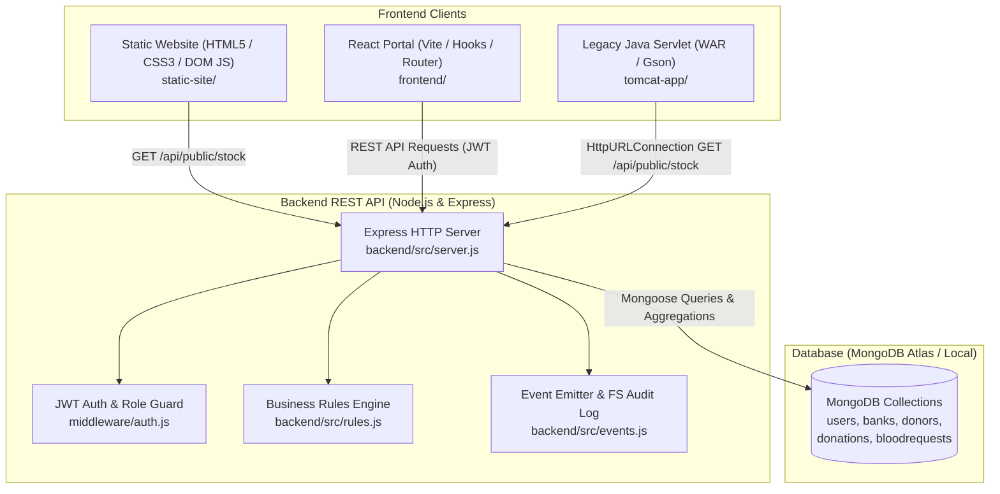

# Blood Bank Management System (Full Stack Web Application)

A modern course-level full-stack web application converted from a legacy Java Swing + MySQL blood bank system. The platform facilitates voluntary blood donor intake, quality laboratory screening, real-time inventory aggregation, and priority hospital emergency dispatches across regional blood banks. Built strictly using core curriculum technologies: HTML5/CSS3, React (Vite), Node.js, Express, and MongoDB Atlas.

---

## 1. System Architecture



---

## 2. Demo Logins

| Role | Username | Password | Organization / Linked Bank |
|---|---|---|---|
| **STAFF (Pune)** | `staff1` | `staff123` | Pune Central Blood Bank |
| **STAFF (Mumbai)** | `staff2` | `staff123` | Mumbai Lifeline Blood Centre |
| **HOSPITAL** | `hosp1` | `hosp123` | Ruby Hall Clinic (Pune) |

---

## 3. How to Run Each Part Locally

### Prerequisites
- Node.js (v18+) and npm
- MongoDB running locally on `localhost:27017` or a MongoDB Atlas connection URI

### Step 1: Configure Environment & Seed Database
```bash
cd backend
cp .env.example .env
# Ensure MONGODB_URI and JWT_SECRET are set in backend/.env
npm install
npm run seed     # Populates 2 banks, 3 demo users, 6 donors, 8 donations, 2 requests
```

### Step 2: Start the Backend API Server
```bash
cd backend
npm run dev      # Runs with nodemon on http://localhost:5000
# Or: npm start
```
*Health Check:* `http://localhost:5000/api/health`

### Step 3: Run the React Frontend Application
```bash
cd frontend
npm install
npm run dev      # Runs on http://localhost:5173
```
Open `http://localhost:5173` to sign in with demo credentials.

### Step 4: View the Static Site (HTML5/CSS3)
Open `static-site/index.html` directly in any web browser, or serve it via a static file server:
```bash
npx serve static-site -l 3000
```

### Step 5: Run Core Node.js Demos (Unit 3 Lab)
```bash
cd backend
npm run demo       # Starts raw Node http/url/fs server on http://localhost:3000
npm run demo:mail  # Tests nodemailer email dispatch fallback
```

### Step 6: Debugging Breakpoints
- In VS Code, press `F5` or select **"Debug Backend API Server"** from the Run & Debug menu.
- Alternatively, launch Node with native inspection enabled: `node --inspect src/server.js`.

---

## 4. Old MySQL → New MongoDB Mapping

| Old MySQL (Legacy System) | New MongoDB Full-Stack System | Architectural Improvement / Rationale |
|---|---|---|
| `user` & `hospital` tables (11 tables total) | `users` collection | Simplified into unified collection with `role` enum (`STAFF` or `HOSPITAL`). |
| `donor` & `donor_phone` (1:N table join) | `donors.phones` (Embedded Array) | Eliminates expensive SQL JOINs; donor phones are retrieved with donor in a single read. |
| `donor_address` (1:1 separate table) | `donors.address` (Embedded Document) | Embedded `{ city, pincode }` subdocument keeps address cohesive with donor record. |
| `stock` table | **No Stock Collection** (Aggregated dynamically) | Stock is calculated on-the-fly using MongoDB `$match -> $group -> $sort`. Eliminates sync anomalies. |
| `request_issue` (M:N junction table) | `bloodrequests.issues` (Referenced Array) | Array of `{ donationId, unitsTaken }` references captures donation batches directly. |
| MySQL Triggers (`trg_donation_bi`) | Pure functions in `backend/src/rules.js` | Business rules (age 18–65, Hb ≥ 12.5, 90-day gap) tested in clean, portable JavaScript. |
| Stored Procedure `sp_adjust_stock` | Aggregation & FEFO loop in `routes/requests.js` | Application handles First-Expiry-First-Out unit consumption in a readable loop. |
| Database scheduled event for expiry | Query-time filtering (`expiryDate >= today`) | Expired blood units are automatically excluded from available stock queries without cron jobs. |

---

## 5. Syllabus Unit → File Traceability

| Unit | Syllabus Concept | Implemented File in this Project |
|---|---|---|
| **Unit 1** | Semantic HTML5, form inputs, native validation | [`static-site/index.html`](file:///C:/Users/Twinkle/.gemini/antigravity/scratch/BloodBankApp/static-site/index.html), [`static-site/donate.html`](file:///C:/Users/Twinkle/.gemini/antigravity/scratch/BloodBankApp/static-site/donate.html) |
| **Unit 2** | CSS Selectors, Box Model, Flexbox, Grid, Media Queries | [`static-site/css/style.css`](file:///C:/Users/Twinkle/.gemini/antigravity/scratch/BloodBankApp/static-site/css/style.css), [`frontend/src/index.css`](file:///C:/Users/Twinkle/.gemini/antigravity/scratch/BloodBankApp/frontend/src/index.css) |
| **Unit 3** | JavaScript DOM manipulation & event handling | [`static-site/js/main.js`](file:///C:/Users/Twinkle/.gemini/antigravity/scratch/BloodBankApp/static-site/js/main.js) (safe `createElement` / `textContent`) |
| **Unit 3** | Regular Expressions & Secure Input Sanitization | [`static-site/js/validate.js`](file:///C:/Users/Twinkle/.gemini/antigravity/scratch/BloodBankApp/static-site/js/validate.js) (strips `<` and `>` tags) |
| **Unit 3** | Node: HTTP module, URL module, File System | [`backend/demos/http-demo.js`](file:///C:/Users/Twinkle/.gemini/antigravity/scratch/BloodBankApp/backend/demos/http-demo.js), [`backend/src/server.js`](file:///C:/Users/Twinkle/.gemini/antigravity/scratch/BloodBankApp/backend/src/server.js) |
| **Unit 3** | Node: EventEmitter & File System append logging | [`backend/src/events.js`](file:///C:/Users/Twinkle/.gemini/antigravity/scratch/BloodBankApp/backend/src/events.js) (logs events to `logs.txt`) |
| **Unit 3** | Node: Multer file upload & `fs.unlink` cleanup | [`backend/src/middleware/upload.js`](file:///C:/Users/Twinkle/.gemini/antigravity/scratch/BloodBankApp/backend/src/middleware/upload.js), [`backend/src/routes/donations.js`](file:///C:/Users/Twinkle/.gemini/antigravity/scratch/BloodBankApp/backend/src/routes/donations.js) |
| **Unit 3** | Node: Nodemailer email integration & Debugger | [`backend/src/mailer.js`](file:///C:/Users/Twinkle/.gemini/antigravity/scratch/BloodBankApp/backend/src/mailer.js), [`.vscode/launch.json`](file:///C:/Users/Twinkle/.gemini/antigravity/scratch/BloodBankApp/.vscode/launch.json) |
| **Unit 4** | MongoDB 5 collections, 1:1, 1:N, M:N relations | [`backend/src/models/`](file:///C:/Users/Twinkle/.gemini/antigravity/scratch/BloodBankApp/backend/src/models) (`User.js`, `Bank.js`, `Donor.js`, `Donation.js`, `BloodRequest.js`) |
| **Unit 4** | MongoDB Aggregation Pipelines & `$lookup` joins | [`backend/src/routes/stock.js`](file:///C:/Users/Twinkle/.gemini/antigravity/scratch/BloodBankApp/backend/src/routes/stock.js) (`/api/stock`, `/api/availability`) |
| **Unit 4** | Full MongoDB CRUD | [`backend/src/routes/donors.js`](file:///C:/Users/Twinkle/.gemini/antigravity/scratch/BloodBankApp/backend/src/routes/donors.js) (POST, GET, PUT, DELETE) |
| **Unit 5** | Git version control workflow | [`docs/GIT_STEPS.md`](file:///C:/Users/Twinkle/.gemini/antigravity/scratch/BloodBankApp/docs/GIT_STEPS.md) (branches `main` and `develop`) |
| **Unit 5** | Jenkins continuous integration pipeline | [`Jenkinsfile`](file:///C:/Users/Twinkle/.gemini/antigravity/scratch/BloodBankApp/Jenkinsfile), [`docs/JENKINS_STEPS.md`](file:///C:/Users/Twinkle/.gemini/antigravity/scratch/BloodBankApp/docs/JENKINS_STEPS.md) |
| **Unit 5** | Apache Tomcat Java Servlet WAR deployment | [`tomcat-app/`](file:///C:/Users/Twinkle/.gemini/antigravity/scratch/BloodBankApp/tomcat-app) (`pom.xml`, `StockServlet.java`), [`docs/TOMCAT_STEPS.md`](file:///C:/Users/Twinkle/.gemini/antigravity/scratch/BloodBankApp/docs/TOMCAT_STEPS.md) |
| **Unit 6** | User registration, bcrypt hashing, JWT authentication | [`backend/src/routes/auth.js`](file:///C:/Users/Twinkle/.gemini/antigravity/scratch/BloodBankApp/backend/src/routes/auth.js), [`backend/src/middleware/auth.js`](file:///C:/Users/Twinkle/.gemini/antigravity/scratch/BloodBankApp/backend/src/middleware/auth.js) |
| **Unit 6** | Cloud deployment Blueprint & steps | [`render.yaml`](file:///C:/Users/Twinkle/.gemini/antigravity/scratch/BloodBankApp/render.yaml), [`docs/DEPLOY_STEPS.md`](file:///C:/Users/Twinkle/.gemini/antigravity/scratch/BloodBankApp/docs/DEPLOY_STEPS.md) |
| **COs** | React Functional Components, Hooks (`useState`, `useEffect`, `useContext`, `useFetch`) | [`frontend/src/`](file:///C:/Users/Twinkle/.gemini/antigravity/scratch/BloodBankApp/frontend/src) (`App.jsx`, `AuthContext.jsx`, `useFetch.js`, `pages/`) |
| **COs** | Postman REST API Testing & Automation | [`postman/BloodBank.postman_collection.json`](file:///C:/Users/Twinkle/.gemini/antigravity/scratch/BloodBankApp/postman/BloodBank.postman_collection.json), [`postman/BloodBank.postman_environment.json`](file:///C:/Users/Twinkle/.gemini/antigravity/scratch/BloodBankApp/postman/BloodBank.postman_environment.json) |

---

## 6. Viva Cheat Sheet (Max 10 Lines)

1. **Why MongoDB documents over 11 relational tables?** Document models allow embedding related entities (`address`, `phones`) inside a single document, reducing complex relational schema overhead and costly multi-table SQL joins.
2. **Embedded vs. Referenced design?** Co-accessed 1:1 and 1:N data (`address`, `phones`) are embedded for single-read speed; independent or high-volume M:N entities (`hospitalId`, `donationId`) are referenced using ObjectIds to prevent document bloat.
3. **Why is stock calculated dynamically via aggregation instead of a stock collection?** Aggregation guarantees that stock is always 100% accurate and mathematically derived from active, screened `Pass` units (`expiryDate >= today`), eliminating data synchronization inconsistencies.
4. **What is FEFO (First-Expiry-First-Out)?** A hospital request sorting strategy that consumes blood units with the earliest expiration date first, minimizing waste and maintaining maximum unit freshness.
5. **How does JWT authentication work?** On login, the server signs a cryptographic token containing user claims (`id`, `role`, `bankId`). The client includes this in the `Authorization: Bearer <token>` header, allowing stateless verification without server session state.
6. **How does Render cloud deployment work?** Render parses `render.yaml` to spin up a Node.js Web Service for the API and static sites for React and HTML, connecting securely over TLS to a managed MongoDB Atlas database.
