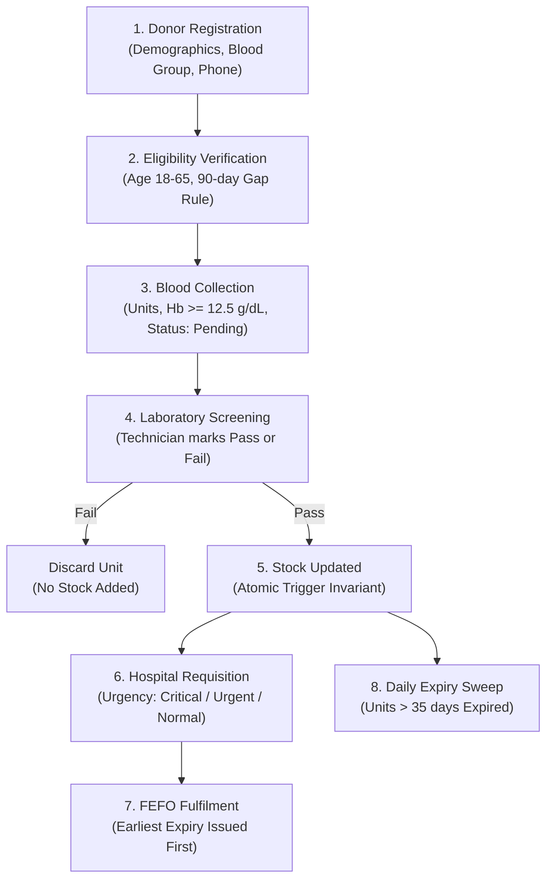

# System Design & Architecture Document

## 1. Problem Statement

Blood banking operations require rigorous medical safety standards, inventory freshness, and concurrency guarantees. Common operational failures in traditional blood systems include:
1. **Double-Issue Race Conditions:** Multiple staff concurrently allocating the same blood units to different urgent requests.
2. **Expired Inventory Waste:** Units sitting in stock past their 35-day viable lifespan without automated identification and discard.
3. **Medical Safety Violations:** Ineligible donors donating too frequently (violating the 90-day cooldown period) or with inadequate haemoglobin levels (< 12.5 g/dL).
4. **Data Tampering:** Modifying historical donor blood groups or altering completed issue audit logs.

This system provides a robust solution with a **Java Swing desktop client** communicating with an **ACID-compliant MySQL 8.0 relational database**. Business rules and concurrency guarantees are locked into the database layer via stored procedures, functions, and triggers, ensuring that no client can inadvertently corrupt data integrity.

---

## 2. Requirements

### 2.1 Functional Requirements
- **FR1: Role-Based Access Control:** Secure user authentication with salted SHA-256 password hashing. Users are segregated into Administrator, Bank Staff, and Hospital roles with polymorphic UI screens.
- **FR2: Master Organization Management:** Administrators can perform complete CRUD operations on Blood Banks, Hospitals, and Staff members.
- **FR3: Donor Registration & Eligibility Checking:** Staff register donors (demographics, blood group, contact numbers). Non-blocking UI hints query stored functions (`fn_is_eligible`, `fn_next_eligible_date`) while database triggers enforce donor age (18–65) and 90-day donation spacing.
- **FR4: Donation Intake & Lab Screening:** Donations are initially logged as `Pending`. Staff assign permanent laboratory screening outcomes (`Pass` or `Fail`). Only a `Pass` adds units to active bank inventory.
- **FR5: Real-Time Stock Inventory & Low-Threshold Alerts:** Comprehensive grid displaying all 8 blood groups across banks. Background polling thread (`StockMonitor`) dispatches notifications when stock falls below `stock.low.threshold`. Rows with low or zero stock are color-coded in Red.
- **FR6: Hospital Requisition Pipeline:** Hospitals raise blood requests with units and urgency levels (`Normal`, `Urgent`, `Critical`).
- **FR7: FEFO Order Fulfilment:** Bank staff fulfil pending requests prioritized by urgency and age. The database procedure automatically selects the earliest-expiring screened units (First-Expired, First-Out) using multi-row locks (`SELECT ... FOR UPDATE`).
- **FR8: Automated Expiry Sweep:** Scheduled database event (`ev_expire_stock`) sweeps expired blood units daily. Administrators can also trigger immediate on-demand sweeps via `sp_expire_all()`.

### 2.2 Non-Functional Requirements
- **Data Integrity:** Strict enforcement of foreign keys, domain `CHECK` constraints, and transactional rollbacks.
- **Concurrency Safety:** Explicit locking hierarchy (`request -> stock row -> donation rows`) preventing deadlocks and double-issuing.
- **Responsive GUI:** Swing background workers (`SwingWorker`) prevent UI freezing during database I/O.
- **Defensive Design:** Try-with-resources connection management; unmodifiable collection encapsulation; error message sanitization (no raw stack traces).

---

## 3. The 8-Step Blood Unit Lifecycle Workflow

1. **Donor Registration:** Donor details are saved to `donor` and `donor_phone` via `sp_register_donor`.
2. **Eligibility Verification:** Database trigger `trg_donation_bi` verifies donor age (18–65) and checks for previous donations within 90 days.
3. **Donation Intake:** Staff record units and haemoglobin ($\ge 12.5\text{ g/dL}$) with status `Pending` via `sp_record_donation`.
4. **Laboratory Screening:** Blood undergoes infectious disease and serological screening via `sp_update_screening`.
5. **Stock Update:** Transitioning from `Pending` to `Pass` fires trigger `trg_donation_au` which executes `sp_adjust_stock`, incrementing `blood_stock.units_available`.
6. **Hospital Requisition:** Hospital representatives raise requests via `sp_raise_request` specifying required blood group, units, and urgency.
7. **FEFO Fulfilment:** Staff execute `sp_fulfil_request`. The procedure locks the request, verifies staff bank membership, locks the stock row, drops any expired units, and selects the earliest-expiring viable donations in a `WHILE` loop.
8. **Expiry Sweep:** Blood older than 35 days is cleared from stock daily by `ev_expire_stock` or on demand by `sp_expire_all`.

---

## 4. Class Hierarchy & Architecture Diagram

```mermaid
classDiagram
    %% Exceptions
    class AppException {
        <<abstract>>
    }
    class ValidationException
    class DatabaseException
    class AuthenticationException
    AppException <|-- ValidationException
    AppException <|-- DatabaseException
    AppException <|-- AuthenticationException

    %% Models
    class Person {
        <<abstract>>
        -int id
        -String name
        -String city
        -List~String~ phones
        +getPhones() List~String~
    }
    class Donor {
        -String gender
        -LocalDate dob
        -String bloodGroup
        -LocalDate nextEligibleDate
    }
    class StaffMember {
        -int bankId
        -String role
    }
    Person <|-- Donor
    Person <|-- StaffMember

    class User {
        <<abstract>>
        -int userId
        -String username
        -String role
        +getTabs()* List~String~
    }
    class AdminUser {
        +getTabs() List~String~
    }
    class BankStaffUser {
        -int staffId
        -int bankId
        +getTabs() List~String~
    }
    class HospitalUser {
        -int hospitalId
        +getTabs() List~String~
    }
    User <|-- AdminUser
    User <|-- BankStaffUser
    User <|-- HospitalUser

    %% DAOs
    class BaseDao {
        <<abstract>>
        #getConnection() Connection
        #wrapSqlException(SQLException) DatabaseException
    }
    class AuthDao
    class BankDao
    class HospitalDao
    class StaffDao
    class DonorDao
    class DonationDao
    class RequestDao
    class StockDao
    BaseDao <|-- AuthDao
    BaseDao <|-- BankDao
    BaseDao <|-- HospitalDao
    BaseDao <|-- StaffDao
    BaseDao <|-- DonorDao
    BaseDao <|-- DonationDao
    BaseDao <|-- RequestDao
    BaseDao <|-- StockDao

    %% UI Panels
    class BasePanel {
        <<abstract>>
        +refreshData()
    }
    class BanksPanel
    class HospitalsPanel
    class StaffPanel
    class StockPanel
    class DonorsPanel
    class DonationsPanel
    class ScreeningPanel
    class RequestsToFulfilPanel
    class RaiseRequestPanel
    class MyRequestsPanel
    class AvailabilitySearchPanel
    BasePanel <|-- BanksPanel
    BasePanel <|-- HospitalsPanel
    BasePanel <|-- StaffPanel
    BasePanel <|-- StockPanel
    BasePanel <|-- DonorsPanel
    BasePanel <|-- DonationsPanel
    BasePanel <|-- ScreeningPanel
    BasePanel <|-- RequestsToFulfilPanel
    BasePanel <|-- RaiseRequestPanel
    BasePanel <|-- MyRequestsPanel
    BasePanel <|-- AvailabilitySearchPanel
```

---

## 5. DB vs. Java Responsibility Split

| Responsibility | Layer Handling It | Mechanism & Implementation |
|---|---|---|
| **Donor Eligibility (Age 18–65, 90-day Gap)** | **Database** | Trigger `trg_donation_bi` with `SIGNAL SQLSTATE '45000'`. Stored functions `fn_is_eligible` and `fn_age_on`. |
| **Haemoglobin Minimum ($\ge 12.5\text{ g/dL}$)** | **Database** | Trigger `trg_donation_bi` rejecting low Hb. Check constraint `ck_don_hb` enforcing range [5, 25]. |
| **Blood Group Immutability** | **Database** | Trigger `trg_donor_bu` prevents modifying a donor's blood group once donations exist. |
| **FEFO Unit Allocation (Earliest Expiry First)** | **Database** | Procedure `sp_fulfil_request` queries `donation` ordered by `expiry_date, donation_id LIMIT 1 FOR UPDATE`. |
| **Preventing Double-Issue / Concurrency** | **Database** | Row locks (`FOR UPDATE`) taken in strict hierarchical order: `blood_request` $\rightarrow$ `blood_stock` $\rightarrow$ `donation`. |
| **Automated Inventory Invariant** | **Database** | Triggers `trg_donation_ai` and `trg_donation_au` call `sp_adjust_stock` on `Pass` screening transitions. |
| **Input Format Validation** | **Java** | `Validator` checks empty fields, 6-digit regex for pincodes, `yyyy-MM-dd` date formatting before sending SQL. |
| **Password Salt & Hash Security** | **Java & DB** | Java `PasswordUtil` generates 16-hex random salt and SHA-256 hash. Pure SQL matches via `SHA2(CONCAT(salt, pw), 256)`. |
| **Role-Based Screen Assembly** | **Java** | Polymorphic invocation of `user.getTabs()` in `MainFrame`. |
| **Background Stock Monitoring** | **Java** | Daemon `ScheduledExecutorService` in `StockMonitor` polling every 10s and dispatching events via `SwingUtilities.invokeLater`. |
| **Non-Freezing Asynchronous Execution** | **Java** | `SwingWorker` threads handle all database I/O for buttons and table loads. |
