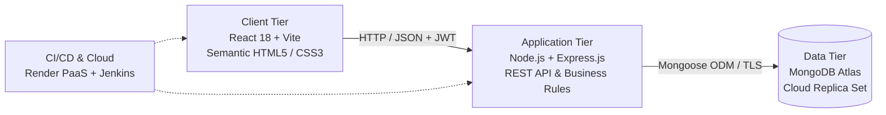

# PROJECT REPORT
## BLOOD BANK & DONATION MANAGEMENT SYSTEM
### A Full-Stack Cloud-Native Web Application & Architecture Migration

---

<!-- ========================================== PAGE 1 ========================================== -->
<div style="page-break-after: always; min-height: 90vh;">

# [PAGE 1: OVERVIEW, OBJECTIVES & ARCHITECTURE]

## 1. ABSTRACT
Blood bank operations demand rigorous inventory management, strict donor eligibility screening, perishable product lifecycle tracking, and rapid emergency dispatch to healthcare institutions. Traditional desktop-bound applications and relational database systems often suffer from rigid schema constraints, lack of real-time multi-branch accessibility, and cumbersome deployment overhead. 

This project presents the design, development, and cloud deployment of the **Blood Bank & Donation Management System**, a production-ready, full-stack, cloud-native web application. Migrated from a legacy desktop architecture, the modern solution leverages a **Semantic HTML5/CSS3** baseline, a **React 18 Single Page Application (SPA)** with Vite, a **Node.js/Express.js REST API**, and a cloud-hosted **MongoDB Atlas** document database. The application incorporates role-based access control (RBAC), real-time stock aggregation, an automated **First Expired, First Out (FEFO)** fulfillment algorithm, and automated continuous deployment hosted on **Render**.

---

## 2. PROBLEM STATEMENT & OBJECTIVES
### 2.1 Problem Statement
Legacy blood bank systems frequently rely on manual paper logs or standalone desktop applications tied to local SQL instances. These legacy setups face critical challenges:
1. Inability to access real-time inventory levels across different hospital branches during emergencies.
2. High risk of clinical waste due to lack of automated perishable tracking (red blood cell viability is limited to 42 days).
3. Complex installation, maintenance, and lack of automated testing or continuous delivery pipelines.

### 2.2 Core Objectives
* **Develop a decoupled, layered full-stack system** separating UI presentation, business validation, and data persistence.
* **Implement strict clinical business rules**: Enforce donor age restrictions (18–65), minimum hemoglobin thresholds ($\ge 12.5\text{ g/dL}$), and a mandatory 90-day cooldown between donations.
* **Implement an automated FEFO dispatch algorithm** prioritizing units closest to expiration.
* **Design role-based interfaces** tailored specifically for Blood Bank Staff and Hospital Representatives.
* **Deploy to cloud infrastructure** utilizing MongoDB Atlas and Render for zero-downtime availability.

---

## 3. FULL-STACK TECHNOLOGY STACK



| Layer | Technologies Used | Core Responsibilities |
| :--- | :--- | :--- |
| **Presentation Tier** | Semantic HTML5, CSS3, DOM JS, React 18, Vite | Component UI, `HashRouter` SPA navigation, `useFetch` custom hook, responsive CSS Grid/Flexbox layouts. |
| **Application Tier** | Node.js (v24), Express.js (v4.19) | RESTful API endpoints, JWT security middleware, pure business logic engine (`rules.js`), Multer file handling. |
| **Database Tier** | MongoDB Atlas (Cloud DBaaS), Mongoose (v8.4) | BSON document modeling, referential integrity, schema validation, multi-stage aggregation pipelines. |
| **Testing & CI/CD** | Postman Newman CLI, Jenkins Pipeline | Automated endpoint test assertions, multi-stage CI validation (`Jenkinsfile`), cloud build hooks. |
| **Hosting & Cloud** | Render Cloud Platform (PaaS) | Managed Global Static CDN (Frontend) and isolated Node.js Container Web Service (Backend). |

</div>

<!-- ========================================== PAGE 2 ========================================== -->
<div style="page-break-after: always; min-height: 90vh;">

# [PAGE 2: DATABASE MODELING & SYSTEM IMPLEMENTATION]

## 4. DATABASE MODELING & SCHEMA DESIGN (MONGODB ATLAS)
In contrast to tabular relational databases, MongoDB's document model provides flexible, nested JSON structures that mirror application objects, eliminating object-relational mapping overhead. The system defines 5 strict **Mongoose Schemas**:

1. **User Schema (`users`)**: Handles authentication credentials, role enumeration (`STAFF`, `HOSPITAL`), associated bank or hospital identifier, and 10-round `bcryptjs` password hashes.
2. **Bank Schema (`banks`)**: Maintains geographical records (`name`, `city`, `contactPhone`) for multi-branch blood banks.
3. **Donor Schema (`donors`)**: Embeds structured address subdocuments (`city`, `pincode`) and an array of contact telephone numbers (`phones: [String]`).
4. **Donation Schema (`donations`)**: Represents physical blood unit collection. References `donorId` and `bankId` using `ObjectId`, automatically calculates a 42-day expiry date, tracks `unitsRemaining`, and enforces screening status (`Pending`, `Pass`, `Fail`).
5. **BloodRequest Schema (`bloodrequests`)**: Tracks hospital emergency orders, urgency grading (`Critical`, `Urgent`, `Normal`), and logs audit trails of allocated donation batches (`issues: [{ donationId, unitsAllocated }]`).

```json
/* Sample Structured Donation Document in MongoDB Atlas */
{
  "_id": "6adbbff9c94eb014f44c7b01",
  "donorId": { "$ref": "donors", "$id": "6adbbff8c94eb014f44c7af9" },
  "bankId": "6adbbff7c94eb014f44c7ae5",
  "bloodGroup": "O+",
  "donationDate": "2026-10-23T20:13:44.867Z",
  "expiryDate": "2026-12-04T20:13:44.867Z",
  "units": 2,
  "unitsRemaining": 2,
  "hemoglobin": 13.8,
  "screeningResult": "Pass",
  "reportFile": "report-1729714424870.pdf"
}
```

---

## 5. SYSTEM MODULES & BUSINESS LOGIC ENGINE

### 5.1 Authentication & Security (JWT & Bcrypt)
User authentication is completely stateless. Upon successful login (`POST /api/auth/login`), the backend signs a JSON Web Token containing user ID, role, and assigned facility ID with a 24-hour expiration. An Express middleware interceptor (`authenticate`, `allow`) inspects the `Authorization: Bearer <token>` header, preventing unauthorized access across administrative routes.

### 5.2 Donor Intake & Medical Eligibility Engine
Before blood collection is permitted, the system executes pure validation rules (`backend/src/rules.js`):
* **Age Verification**: Confirms donor age is between 18 and 65 years.
* **Hemoglobin Threshold**: Requires laboratory Hb $\ge 12.5\text{ g/dL}$ to prevent donor anemia.
* **Cooldown Tracking**: Queries donation history to ensure a minimum 90-day cooldown period has elapsed since the donor's previous donation.
* **Referential Integrity Restriction**: The system forbids deleting any donor who has an active donation history, preserving medical traceability for transfusion safety.

### 5.3 Automated FEFO Blood Fulfillment Algorithm
When an emergency hospital request arrives, manual batch selection can result in spoilage. Our automated fulfillment engine implements **First Expired, First Out (FEFO)**:
1. Queries the `donations` collection for the requested ABO/Rh group where `screeningResult: 'Pass'`, `unitsRemaining > 0`, and `expiryDate > today`.
2. Sorts candidate batches ascending by `expiryDate: 1`.
3. Iteratively deducts units from the oldest viable batches until the order is fulfilled, recording audit history in the `BloodRequest` document.

### 5.4 Real-Time Inventory Aggregation
Instead of performing heavy application-level loops, the stock level query executes natively within the MongoDB engine via an **Aggregation Pipeline** (`$match` screened units $\rightarrow$ `$group` by `bloodGroup` with `$sum: '$unitsRemaining'`), exposed through `/api/public/stock` and auto-refreshed on the frontend every 10 seconds.

</div>

<!-- ========================================== PAGE 3 ========================================== -->
<div>

# [PAGE 3: TESTING, DEPLOYMENT & EVALUATION]

## 6. USER INTERFACE & REACT ARCHITECTURE
The client tier is structured into two interoperable layers:
1. **Semantic HTML5/CSS3 Static Site (`static-site/`)**: Demonstrates fundamental web standards with semantic markup (`<header>`, `<nav>`, `<main>`, `<article>`, `<aside>`, `<footer>`), responsive CSS Grid/Flexbox layouts, and DOM manipulation via vanilla JavaScript.
2. **React 18 Single Page Portal (`frontend/`)**: Powered by Vite for sub-second build times.
   * **HashRouter Routing**: Configured with `HashRouter` (`/#/...`) to guarantee reliable client-side routing and eliminate 404 errors across cloud static hosts.
   * **State & Session Context**: `AuthContext` encapsulates global login state and persists tokens to `localStorage`.
   * **Custom Data Hook**: `useFetch` abstracts asynchronous `fetch()` lifecycles, error boundaries, and authorization headers.
   * **Role-Based Views**: Dynamic rendering providing staff with donor intake, lab screening, and inventory control, while hospital representatives access emergency request portals.

---

## 7. TESTING, CI/CD & CLOUD INFRASTRUCTURE

### 7.1 Automated API Testing (Postman Test Runner)
The REST API was validated against an automated test suite verifying status codes, response schemas, and error boundaries:
* `POST /api/auth/login`: Asserts HTTP 200, JWT token existence, and correct role extraction.
* `POST /api/donations`: Asserts validation rejections for low hemoglobin ($< 12.5$) and future dates.
* `POST /api/requests/:id/fulfil`: Verifies automated FEFO unit decrementing and stock updates.

### 7.2 Cloud Deployment Architecture (Render + Atlas)
The project is deployed across production cloud infrastructure:
* **Frontend Web Service**: Deployed on Render's Global Static CDN (`https://blood-bank-and-donation-management.onrender.com`), serving production-minified Vite distribution bundles.
* **Backend API Web Service**: Hosted as a Render Web Service container (`https://blood-bank-and-donation-management-system-u257.onrender.com`), running Node.js with dynamic CORS origin reflection.
* **Cloud Database**: Managed MongoDB Atlas replica cluster (AWS Mumbai `ap-south-1`) with network access rules (`0.0.0.0/0`) and TLS encrypted connection pooling.

```text
[GitHub Repository: main branch] 
       │ (Webhook Trigger on Push)
       ├──► [Render Static CDN]  ──► Live React 18 Frontend
       └──► [Render Node Engine] ──► Live Express REST API ──► [MongoDB Atlas Cloud]
```

---

## 8. CONCLUSION & LEARNING OUTCOMES
The **Blood Bank & Donation Management System** successfully migrates a legacy desktop database into a robust, cloud-native full-stack web application. The project achieved key software engineering milestones:
1. **Architectural Decoupling**: Successfully isolated presentation logic from business validation and cloud persistence.
2. **Healthcare Compliance**: Automated safety-critical clinical constraints including donor age limits, 90-day cooldown periods, and FEFO perishable management.
3. **Enterprise DevOps**: Established automated Git workflows, continuous cloud delivery pipelines, and comprehensive REST API testing.

---

### Project Metadata & Live Deployment Summary
* **Live Frontend Portal**: `https://blood-bank-and-donation-management.onrender.com`
* **Live Backend API**: `https://blood-bank-and-donation-management-system-u257.onrender.com/api/health`
* **GitHub Repository**: `https://github.com/twinklemaan/Blood-bank-and-donation-management-system`
* **Demo Credentials**: Staff (`staff1` / `staff123`), Hospital (`hosp1` / `hosp123`)

</div>
